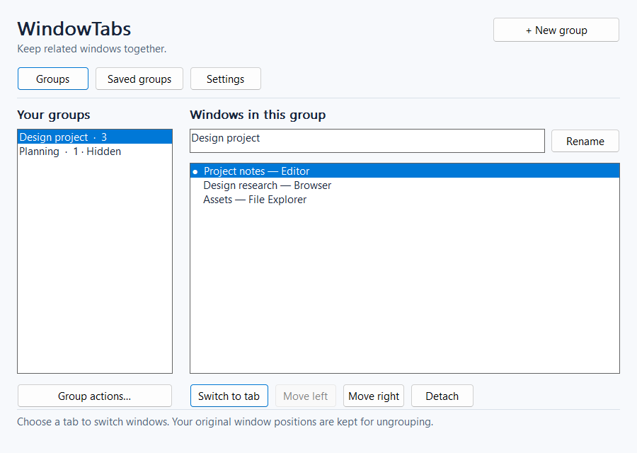
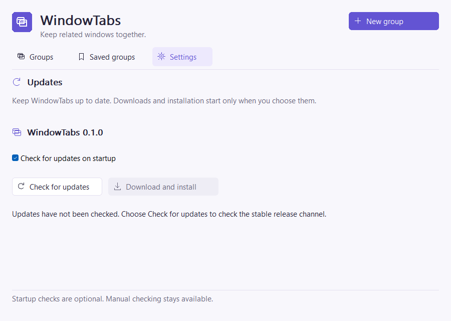

# WindowTabs

WindowTabs groups existing, ordinary Windows application windows behind a separate native tab strip. Select related windows, switch between them in one place, and restore their original placements when finished.

**Version 0.2.0** adds six interface languages and saved light/dark themes. The Windows source builds and synthetic tests are available; interactive desktop compatibility and live update installation still require validation.

The manager separates **Groups**, **Saved groups**, and **Settings**. Colored window-type badges, labeled action icons, and a soft violet palette help identify windows and everyday actions. Creating a group opens a focused window picker; everyday switching stays in the small tab strip. [Design and rendering notes](docs/DESIGN.md) explain the workflow and verification scope.

WindowTabs is an independent MIT-licensed implementation. The [Groupy product](https://www.stardock.com/products/groupy/) inspired the user task. WindowTabs has no affiliation with Stardock and uses no competitor code, branding, or assets.

## Implemented capabilities

- Discover eligible, non-elevated, resizable application windows and select several using Ctrl or Shift.
- Create and name groups, add windows, switch native tabs, reorder members, detach windows, and close groups without closing their applications.
- Keep one member visible at the group's bounds; preserve original normal/minimized/maximized placement and visibility for restoration.
- Follow active-window move/resize and process/window exit through process-scoped, out-of-context WinEvents. No DLL injection, reparenting, target style changes, global keyboard hooks, service, or driver.
- Reserve space for the tab strip inside the active monitor's work area, including negative monitor coordinates and per-monitor DPI. Minimized groups can be restored from the manager.
- Save ordered group definitions and explicitly restore them against already-open windows. Matching uses executable path, window class, and exact title; missing or ambiguous windows produce an error instead of guessing or launching applications.
- Write a recovery journal before manipulating any window. The next launch offers **Recover windows** after an interrupted session; uncertain identities and unsuccessful restorations retain their recovery records.
- Show installed version, manual **Check for updates**, a persistent startup-check opt-out, and user-initiated **Download and install** with progress, SHA-256 verification, backup, executable replacement, and restart code.

## Requirements and build

Target: Windows 10 version 1703 or later / Windows 11, x64, ordinary unelevated desktop session. Compatibility on actual desktops remains pending. Run as a normal user; the application never requests elevation. The package uses the static MSVC runtime and Windows system libraries, with no WebView or separate runtime installation.

Build with an existing Rust MSVC toolchain and Visual C++ linker / Windows SDK. Keep the local `rust-auto-updator` workspace beside this repository (`../rust-auto-updator/crates/rust-auto-updator`); it is required for source builds. Standalone CI checkouts use the pinned revision in `scripts/provision-shared-updater.ps1` before verification. Rust 1.96.1 was used for local verification; the declared minimum is 1.95, which was not separately tested.

```powershell
cd E:\work\github\window-tabs
.\scripts\verify.ps1 -Offline
.\scripts\package.ps1 -Offline
```

Remove `-Offline` when dependencies are not already cached. Cargo is limited to two jobs and the repository-local `target` directory. The package is `dist\v0.2.0\WindowTabs-v0.2.0.exe`, accompanied by `SHA256SUMS.txt`, the license, and [third-party notices](THIRD_PARTY_NOTICES.md). Packaging inspects the PE architecture, GUI subsystem, embedded manifest and application icon, and DLL imports without running the EXE. A resource-only native proof is available through `scripts/inspect-icons.ps1`; it loads the packaged EXE as data, validates native sizes and alpha, and saves `DrawIconEx` samples on light/dark backgrounds without starting the app. The original logo is in `assets/window-tabs.svg`; `scripts/generate-icon.ps1` rebuilds its multi-resolution ICO with Windows System.Drawing. The build embeds the checked-in ICO using the Windows SDK resource compiler.

## Use after interactive validation

1. Start WindowTabs, open the desired application windows, and choose **New group**. Use **Refresh windows** inside the picker when the open windows change. The list intentionally omits ineligible windows.
2. Select at least two windows, enter a name, and choose **Create group**. The first selected entry defines the initial monitor and bounds. Selection follows the list's title order.
3. Click a tab, use its native arrow navigation, or double-click a member in the manager. The strip's **…** menu includes previous/next, move left/right, detach, show manager, and close group. Ctrl+Tab / Ctrl+Shift+Tab work while the manager or strip has focus; they do not intercept input in other applications.
4. Move or resize the active application's title bar/borders to reposition the group. Bounds are constrained to one monitor's work area with space reserved above for the strip. Maximizing an active member expands the group into that work area; it becomes a restored window so the strip has room. Minimizing hides the strip; select a member and **Switch** to restore it.
5. **Group actions** contains **Add windows**, **Save group**, and **Ungroup and restore windows**. Save stores current titles and order; a name already present replaces that definition. On **Saved groups**, select a definition and choose **Restore saved**. It requires the same applications and exact titles to be open and does not reopen documents or run programs. A successful create/restore selects the resulting group.
6. **Detach**, **Ungroup and restore windows**, or closing the manager restores original placements and show states. An original minimized window returns minimized. The strip's **×** closes the group, not an application. A failed restoration puts the group into **recovery required** mode: its strip is hidden, automatic regrouping/switching stops, and its journal remains for retry through Group actions or Detach. Normal shutdown waits for restoration and its journal write to succeed, or for the target to exit. Exiting an inactive member does not unminimize its group or affect another group.

The manager stays on the taskbar; there is no tray mode. A second instance reports the existing instance instead of taking control of its groups.

## Settings, privacy, and updates

Open **Settings** and choose **Language** to switch between **English**, **Русский**, **Français**, **Deutsch**, **Español**, and **Italiano**. The **Theme** button switches between **Light** and **Dark**. Both preferences are saved immediately by the background worker and apply without restarting, including the manager, window lists, tab strips, and their action menus. Existing installations keep English and the light theme until changed. Windows high-contrast colors take precedence. Window titles, saved group names, application paths, and raw OS/network diagnostic details keep their original text.


Own data lives in `%LOCALAPPDATA%\WindowTabs\settings.json` and `recovery.json`. Settings contain saved names, executable paths, window classes, and titles. Recovery also includes process creation times, HWNDs, placements, and visibility. These local files are not encrypted; normal operation does not capture documents or screenshots and uploads no window data. The developer-only capture mode below renders synthetic fixtures into a requested local file. Do not remove a nonempty recovery journal before recovering affected windows.

A valid recovery journal remains usable if settings are corrupt or from an unsupported schema. WindowTabs preserves the settings file and enters a recovery-only mode with startup network checks disabled; recover windows, then repair settings and restart. Older journals without saved physical monitor coordinates remain readable. When the original monitor is gone, recovery chooses reachable normal bounds and waits for that placement instead of accepting an unrelated visible window state.

The **Settings** area displays the installed version. Startup checking is enabled by default and uses a separate bounded worker. Turning **Check for updates on startup** off prevents startup update requests on subsequent launches, and manual checking remains available. Errors and no-update results stay in the settings area without popup dialogs. The only normal network operation is checking/downloading updates from the [canonical repository](https://github.com/siarheisinelnikau/window-tabs); an unavailable repository/release is shown as unavailable, not “up to date.”

Installation requires clicking **Download and install** and completing any previous-session recovery first. The shared `rust-auto-updator` core downloads stable `WindowTabs-vVERSION.exe` plus `SHA256SUMS.txt`, checks byte length, SHA-256, x64 GUI PE headers, section bounds and executable entry point, and prepares a unique `.window-tabs-update-*` staging folder beside the installed EXE. WindowTabs restores all groups and saves its journal before handing off installation. A helper-launch failure keeps the manager open and recreates its window worker so the user can retry.

The downloaded executable provides the shared helper protocol. After verifying the original process and waiting for it to exit, the helper rechecks the old hash, replaces the EXE with a backup, and restarts it. Failed process creation restores and attempts to restart the previous executable. Settings and group definitions remain in the data directory. Successful startup acknowledges the update and schedules cleanup of validated staging files. Read-only installation folders fail without elevation. Legacy WindowTabs releases launch a copy of their own old executable as helper, so their existing installation transaction continues independently when upgrading to this version. End-to-end network/install/restart and actual desktop grouping remain unverified in this code-only pass.

## Limits and verification status

Excluded: elevated/protected/hung applications, owned/modal/tool/topmost/untitled/fixed-size windows, shell surfaces, legacy console windows, UWP `ApplicationFrameWindow` frames, and windows cloaked on another virtual desktop. Apps that ignore hide/resize requests, recreate their HWND, or impose incompatible minimum sizes may not group successfully. Applications with native tab containers or custom chrome need manual validation. HWND/PID/process-start/class checks reduce handle-reuse risk; Win32 has no atomic identity-and-window-operation primitive, so exit races cannot be eliminated completely.

Modal dialogs must be closed before changing their parent tab. Hidden tabs generally leave Alt+Tab and the taskbar; use the strip or manager to select them. Taskbar/Alt+Tab integration, drag-to-group, dragging tab headers to reorder, automatic application launching, global shortcuts, virtual desktop following, snap-layout integration, and Explorer integration are outside this first version. Use **Left / Right** in the manager or the strip's **Move active tab left/right** commands to reorder.

Local noninteractive results and the remaining manual matrix are in [docs/VALIDATION.md](docs/VALIDATION.md). Architecture and API references are in [docs/ARCHITECTURE.md](docs/ARCHITECTURE.md). Initial release text is in [CHANGELOG.md](CHANGELOG.md).

## Screenshots

The images below document **version 0.1.0**; the language/theme controls and dark palette introduced in 0.2.0 have not been captured because this pass retains the repository’s code-only/no-launch restriction. Updated main and Settings screenshots, translated-label clipping, native theme details, and runtime rendering measurements remain pending.

These are real application-generated client-area images from the packaged EXE, using the same native Win32 controls and GDI rendering as normal operation. The window names are synthetic fixtures. No visible windows, user applications/settings, screen capture, or computer use were involved. They establish static layout, not successful grouping on a real desktop.





Additional reviewed states: [window picker](docs/screenshots/picker.png), [empty](docs/screenshots/empty.png), [saved groups](docs/screenshots/saved.png), [recovery](docs/screenshots/recovery.png), [error](docs/screenshots/errors/error.png), and the [minimum-size manager](docs/screenshots/minimum/groups.png).

To reproduce the isolated render-save-exit diagnostic into a fresh output directory:

```powershell
.\scripts\capture-ui.ps1 -Executable .\dist\v0.2.0\WindowTabs-v0.2.0.exe -OutputDirectory .\target\new-ui-captures
```

The script imposes a 20-second process timeout; each invocation renders one composite image and exits. It never activates an existing instance or starts discovery, event hooks, update requests, or persistence. Captures of actual grouped desktop windows/tab strips and interactive keyboard/focus/DPI testing remain pending.

